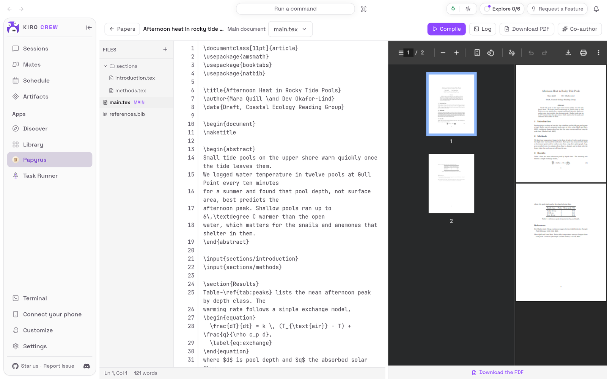
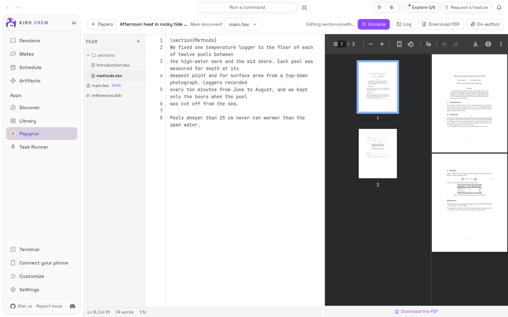
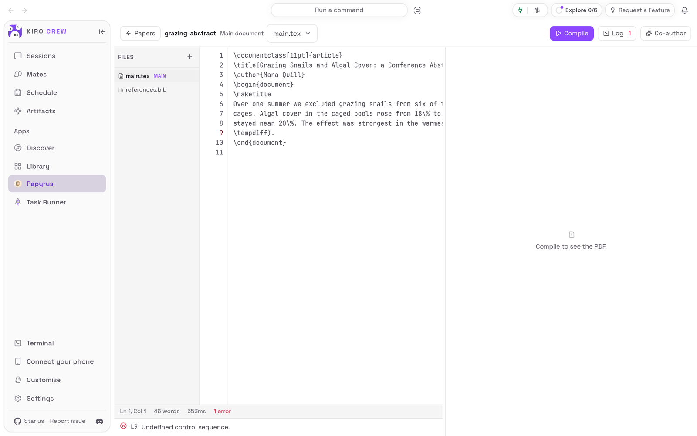

# Papyrus

<picture>
  <source media="(prefers-color-scheme: dark)" srcset="docs/media/hero-dark.png">
  
</picture>

**Write a LaTeX paper next to its PDF, on your own computer, with an AI co-author a click away.**

Papyrus is an app for [Kiro Crew](https://github.com/kirodotdev/KiroCrew),
the open-source personal AI agent.

## What it is

Papyrus adds a **Papyrus** page to Kiro Crew. It keeps your LaTeX papers, shows
the source and the compiled PDF side by side, and builds the PDF when you press
**Compile** or Cmd+S (Ctrl+S on Windows and Linux). When a build fails it lists
the errors, and a click takes you to the line. **Co-author** opens a Kiro Crew
chat that already knows which paper you mean, so you can ask for a review or an
edit.

**Get started:** open **Apps → Library**, open the **⋯** menu on **Papyrus** and
choose **Enable**. [Install](#install) has the details.

## The problem it solves

Writing a paper in LaTeX usually means a hosted editor that keeps your drafts on
someone else's server, or a local TeX install of several gigabytes and a
terminal. Asking an assistant for help then means copying text back and forth.

Papyrus keeps every paper in a folder on your computer and needs no TeX
installation: if you have none, one button installs a single, checked compiler
into Papyrus's own folder. The co-author works on the same files you are
editing.

Papyrus never lets a document run commands: the compiler always runs with
shell escape off. On a Mac or Linux it also runs inside Kiro Crew's sandbox, so
a paper you cloned from somewhere cannot reach your other files. Windows has no
such sandbox, so there Papyrus compiles only if whoever runs Kiro Crew chooses
to allow programs to run unsandboxed, and a paper's compiler can then reach
whatever Kiro Crew can.

## Top 3 use cases

### 1. Write and see the PDF straight away

You are drafting the methods section of a paper. Pick
**sections/methods.tex** in the file tree, add a sentence, and press Cmd+S. Papyrus
saves the file and builds the whole paper (bibliography included), and the PDF
on the right updates. The bar under the editor shows the caret position, the
word count and how long the build took.



### 2. Find the line that breaks the build

Your conference abstract will not compile. Press **Compile**: Papyrus lists what
went wrong under the editor and marks the line in the left margin. Here it is
**L9 Undefined control sequence.**, a macro that was never defined. Click the
message and the caret jumps to line 9.



### 3. Ask the co-author about your paper

You want a second opinion on your methods section before the reading group.
Open the paper and choose **Co-author**. Papyrus saves your work and opens a new
chat in **Sessions** whose message box already says which paper this is and which
file is its main document; type your request after it and send. Here the request
was to suggest two sentences in `sections/methods.tex` that could be shorter,
without editing any file. The co-author read the section and offered two shorter
versions next to the originals, said it had not changed any file, and asked the
author to check that one wording change still meant the same thing. It can also
edit the files when you ask it to and approve the change; press **Compile** back in
Papyrus to see the result.

![A co-author chat in Sessions for the tide-pool paper: after the paper's context and the request to suggest two sentences in sections/methods.tex that could be shorter without editing any file, the agent reads its skill and the methods section, then offers two rewrites as old and shorter LaTeX (the depth and surface-area sentence in the active voice, and the logger sentence with the date range and a semicolon), says it did not change any file, and asks the author to check that 'each pool' still means what they want](docs/media/use-case-coauthor-light.png)

## Watch it


[Watch the walkthrough as a video (MP4)](docs/media/walkthrough.mp4).

<sub>Recorded from a real Kiro Crew dashboard (Kiro Crew `f360976c1b`, with
this repository installed into a throwaway home in place of the copy that comes
with Kiro Crew) with made-up papers. The compiler is the Tectonic that Papyrus
installs itself. The walkthrough sends no chat message. The co-author reply in
use case 3 comes from a live AI model and will vary. The waits for builds are
shortened in the video.</sub>

## Install

**Today: Papyrus comes with Kiro Crew.** Nothing needs downloading. It starts
switched off:

1. In Kiro Crew, open **Apps → Library** in the left sidebar.
2. Choose **Show N disabled apps** (N is how many apps are switched off).
3. On the **Papyrus** tile, open the **⋯** menu and choose **Enable**.
4. **Papyrus** now appears under **Apps** in the sidebar.

The copy that comes with Kiro Crew shows the co-author as a panel beside the PDF
and colours the LaTeX source; this repository's copy, pictured here, does not yet
(see [Development](#development)).

**Coming later: from the Kiro Crew App Store.** Once this app is listed there:

1. Open **Apps → Discover** in the left sidebar.
2. Search for **Papyrus** and choose **Install**.
3. Kiro Crew asks **Trust “Papyrus” to run its own code?** Papyrus runs a small
   program of its own inside Kiro Crew to keep your papers, build them and run
   git. Trusting it gives that program the same access Kiro Crew has (your
   files, your saved sign-ins and the internet), as the dialog says. If you are
   happy with that, choose **Trust this app**. You can take it back later in
   **Settings → Security → Third-party apps**.
4. The app installs switched off. Choose **Enable** on its page.

What you need: Kiro Crew on a Mac, Linux or Windows computer. For **Co-author**,
Kiro Crew must already be able to chat. For **Clone** and the git buttons, git
must be installed, and a remote that needs a sign-in must already work from your
computer without asking for a password. No accounts or keys are needed
otherwise.

On Windows, Kiro Crew has no sandbox for the compiler, so Papyrus refuses to
compile until whoever runs Kiro Crew allows programs to run unsandboxed (see
[Troubleshooting](#troubleshooting--faq)). Only compile papers you trust there.

## First run

Open **Papyrus** from the sidebar. The page says **No papers yet**. If your
computer has no LaTeX compiler, a yellow note says so and offers **Install
compiler**: press it once and wait for it to finish (about 10 to 25 MB is
downloaded). If you already have TeX Live (`pdflatex`) or Tectonic, Papyrus uses
that and shows its name under **Compiler**.


## How to use it

1. **Start a paper.** Type a name in **Name your paper…** and choose **Create**.
   The name becomes the paper's folder, so it may use only lowercase a–z, 0–9,
   `.`, `-` and `_`. Papyrus starts it from a standard article template with a
   `main.tex` and an empty `references.bib`. Or paste a git address into
   **Clone from a git URL…** and choose **Clone** to copy an existing paper.
2. **Open it.** Choose the paper in **Your papers**. The pencil button renames
   what the list shows; the bin deletes the paper and all its files.
3. **Write.** Pick a file in **Files**, type in the middle pane, and add a file
   with **+**. **Main document** picks the file that is compiled.
4. **Build.** Press **Compile**, or Cmd+S (Ctrl+S on Windows and Linux), which
   saves and compiles. A paper that cites anything gets its bibliography built
   too. **Download PDF** saves the result.
5. **Fix errors.** A failed build opens the **Log** list under the editor. Click
   a message to jump to its line. **Log** shows or hides the list.
6. **Ask the co-author.** Choose **Co-author**. Papyrus saves your changes and
   opens a new chat in **Sessions** whose message box already names the paper.
   Type what you want after it and send. When you come back to **Papyrus** it
   re-reads the open file; press **Compile** to see the agent's changes in the PDF.
   If you had unsaved changes in a file the co-author also changed, Papyrus says
   **Co-author changed this file** and will not save over its version (see
   [Troubleshooting](#troubleshooting--faq)).
7. **Use git (cloned papers).** The toolbar shows the branch. **Pull** fetches
   changes; **Commit & Push** asks for a message, then commits every change in the
   paper and pushes.

## Settings & data

- **Where your data lives:** each paper is a folder in
  `~/.kiro/crew/apps/papyrus/data/projects/` (or in the same place under the
  folder you chose for Kiro Crew's data, if you moved it), and the compiler Papyrus installs is in `…/apps/papyrus/data/vendor/tectonic/`.
  Nothing is uploaded by Papyrus itself.
- **What goes over the internet:** **Install compiler** downloads Tectonic from
  its official GitHub release, and Papyrus checks the file against a fixed
  fingerprint before using it. While compiling, Tectonic downloads the LaTeX
  packages a paper needs. **Clone**, **Pull** and **Commit & Push** talk to your
  git remote. Co-author chats use the same AI model as the rest of your Kiro Crew.
- **Who can use it:** only the person who set up this Kiro Crew. If someone
  shared their Kiro Crew with you, Papyrus refuses every request from you.
- **Turn it off:** **Apps → Library**, open the **⋯** menu on Papyrus, choose
  **Disable**. Your papers are kept.
- **Remove it** (once it is installed from the App Store): the same menu,
  **Uninstall**. **Keep app data** is ticked; untick it to delete your papers too.
  The copy that comes with Kiro Crew can be switched off but not removed.

## Troubleshooting / FAQ

**"No LaTeX compiler was found on this machine."**
Choose **Install compiler**. If the note says to install TeX Live or Tectonic
instead, your kind of computer has no ready-made Tectonic build; install TeX Live
or Tectonic yourself and reload the page.

**A build fails with a message about the sandbox.**
Kiro Crew could not put the compiler in its sandbox, so Papyrus did not run it.
On Windows there is no sandbox at all: whoever runs Kiro Crew can allow programs
to run unsandboxed in its settings, and the compiler then runs without one (the
setting is named in [Development](#development)). Elsewhere, try again; if it
keeps failing, the message says what to change.

**"Refusing to compile: … exist as symbolic links."**
The paper folder contains links (often from a cloned repository). The compiler
writes files by name and could overwrite whatever a link points at, so Papyrus
will not compile. Delete the links and try again.

**The co-author's changes do not show in the PDF.**
Papyrus does not compile by itself. Press **Compile**.

**"Co-author changed this file", and the editor will not let me type.**
You had unsaved changes in a file while the co-author changed the same file
(this can happen when Papyrus is open in another tab or window). Papyrus stops
you from saving, because saving would replace the co-author's version with
yours. Copy any of your text you want to keep, then choose **Discard my changes
and reload**: the editor shows the co-author's version, and you can add your
changes back to it.

**"Paper names become folder names, so they can use only lowercase Latin letters …"**
Use only lowercase a–z, 0–9, `.`, `-` and `_`, starting with a letter or digit,
at most 64 characters. When one character is to blame, the message names it
instead ("“É” can't be used in a paper name").

**Push says I am not signed in.**
Papyrus never asks for a password. Make sure pushing to that remote already works
on your computer without one (with an SSH key or a saved sign-in), then try
again.

**Papyrus shows an error on every action, saying only the owner may do it.**
You are using a Kiro Crew someone else set up and shared with you. Only its owner
can use Papyrus.

## Development

This repository is the externally packaged form of the `papyrus` app that ships
built into Kiro Crew. The two share a name, a version and the same permissions,
so the Kiro Crew release that adds built-in adoption can move an existing
built-in install onto this source in place, at a commit pinned in that release:
papers and settings stay where they are. Until a user's Kiro Crew does that, it
keeps running its built-in copy, and nothing here changes what they run.
[PORTING.md](PORTING.md) lists every place this copy differs from the built-in
and why; the biggest is that the co-author opens in Sessions instead of a panel,
because embedding a chat needs a permission the built-in never declared.

| Path | What it is |
|---|---|
| `app.json` | The app manifest, including the `ui` entry, the declared skills and the `l10n` listing copy |
| `backend/routes.py` | The 20 in-gateway routes (`backend.hooks.routes`), owner-gated |
| `backend/store.py` | Paper folders and the path-containment gate |
| `backend/latex.py` | Compiler discovery, the sandboxed compile cycle, log parsing |
| `backend/gitops.py` | Clone, status, commit, push and pull, with every repository-config hook neutralized |
| `backend/tectonic.py` | The managed, sha256-pinned Tectonic install |
| `backend/_host.py` | The only module that touches the gateway |
| `backend/_compat.py`, `_fs.py`, `slugs.py` | Small helpers restated from Kiro Crew |
| `skills/papyrus-*` | The co-author's skills |
| `ui/src/` | The dashboard page (React), built against `@kirocrew/app-sdk` |
| `ui/i18n/` | The page's strings in every language the dashboard ships |
| `ui/dist/index.mjs` | The built page, **committed**: an install is a plain clone with no build step |
| `ui/tests/` | UI tests (vitest + jsdom), with light stand-ins for the host SDK |
| `assets/` | Store icon, hero art and screenshot (raster, as the catalog requires) |
| `tests/` | Backend and manifest tests, runnable offline with pytest |
| `capture/` | Captures the README media from a real, isolated Kiro Crew ([capture/README.md](capture/README.md)) |
| `docs/media/` | The README pictures and walkthrough, plus `media.json` (sizes, alt text, commits) |

### What it needs from Kiro Crew

Kiro Crew 0.12.0 or later (`minKiroCrewVersion`): App Kit level 1, which gives an
app's hooks an owner gate (`ctx.require_owner`) and structural route records, and
gives its page `Select` and `guideCaution`. Papyrus also uses `ctx.scrub` (output
redaction) and `ctx.audit` (the security event log).

The compiler and git must run inside Kiro Crew's sandbox, and no App Kit seam
offers that yet. Where the gateway has no sandbox (Windows), the gateway's own
`agent.sandbox_allow_unsandboxed_exec` opt-in decides: off, Papyrus refuses to
compile or run git; on, the gateway runs them unwrapped. The data folder is
`$KIROCREW_HOME/apps/papyrus/data/` when `KIROCREW_HOME` is set. `backend/_host.py` therefore looks up the gateway's sandbox,
sensitive-path gate, pinned file reader, git-hook scanner and verified downloader
by name at the moment it needs them, and when one is missing it refuses the
operation instead of running it unprotected; `register_routes` reports what is
missing through the app's health. No other backend module names `kiro_crew`
(`tests/test_no_host_imports.py`).

### Install from a clone

```bash
git clone https://github.com/KiroCrewCaptain/kirocrew-app-papyrus
kirocrew app install ./kirocrew-app-papyrus
```

Then turn it on from **Apps → Library**. The app runs its own code
(`backend.hooks` in `app.json`), so Kiro Crew will not enable it until you trust
it: the Library's **Enable** opens **Trust “Papyrus” to run its own code?**, and
**Trust this app and enable** does both. Until it is trusted,
`kirocrew app enable papyrus` is refused with `app_execution_denied`; there is no
command-line trust step.

While your Kiro Crew still has the built-in copy installed, the install itself is
refused: `app 'papyrus' is already installed`. From a terminal,
`kirocrew app disable papyrus` turns the app off, and
`kirocrew app uninstall papyrus` (add `--purge-data` to delete the papers)
removes an installed copy.

### Tests

Backend and manifest:

```bash
python -m pip install -r tests/requirements.txt
python -m pytest
python -m flake8 backend tests
```

These need neither Kiro Crew nor the network. `tests/fakehost.py` stands in for
the gateway (its sandbox runs the argv unwrapped, its path gate knows a few
names) and for the app context; the real-git tests need `git` on `PATH`.

UI (Node 24, from `ui/`):

```bash
npm ci
npm run typecheck
npm test
npm run build
```

`npm run build` writes `ui/dist/index.mjs`. Commit it with the source change that
produced it: CI rebuilds it from a clean `npm ci` and fails if the result differs.
The bundle imports only the modules the dashboard provides;
`tests/test_manifest_contract.py` checks that, and that every name it imports by
name exists on a Kiro Crew without the level-1 seams. A UI string goes into
`ui/i18n/en.json` and every other catalog there.

### Re-capture the README media

The pictures and the recording come from a real, isolated Kiro Crew gateway
driven by [`capture/`](capture/README.md). While Kiro Crew still ships the
built-in Papyrus, the gateway's checkout must have it removed
(`src/kiro_crew/apps/builtins/papyrus`, its `BUILTIN_NAMES` entry and
`src/kiro_crew/builtin_skills/papyrus-*`) so that this repository is the copy
installed, and the capture must run from a clean clone so the install copies no
`node_modules`:

```bash
git clone . /tmp/papyrus-clean && cd /tmp/papyrus-clean
python capture/capture.py --kirocrew /path/to/that/KiroCrew --out /path/to/this/repo/docs/media
python capture/check_readme.py /path/to/this/repo/README.md
```

Then look at every image and at a few frames of the video before committing
(see [CHECKLIST.md](CHECKLIST.md)).

## License

Apache License 2.0. See [LICENSE](LICENSE) and [NOTICE](NOTICE). Papyrus is
ported from the Papyrus app by tricatte; see [ATTRIBUTION.md](ATTRIBUTION.md).
